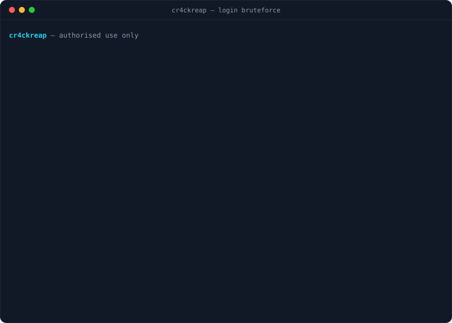

# cr4ckreap

[](https://github.com/grimh3xx/cr4ckreap/actions)
[](LICENSE)


**Bruteforce de login multi-protocolo em Rust** para pentest autorizado — o irmão
"online" do [credreap](https://github.com/grimh3xx/credreap). Engine concorrente
com um protocolo por módulo e parada opcional no primeiro acerto.

<p align="center"></p>

> ## ⚠️ Uso autorizado apenas
> Bruteforce/spray contra serviços sem permissão é crime e pode travar contas.
> Rode **somente** com escopo e autorização. A responsabilidade é sua.

## Protocolos

| protocolo | estado |
|---|---|
| `ftp`        | ✅ funcional (USER/PASS, códigos 230/530) |
| `http-basic` | ✅ funcional (Authorization: Basic, 401/403 = negado) |
| `ssh`        | 🚧 planejado (via `russh`) |

## Uso

```sh
cr4ckreap ftp 10.0.0.5 -u admin -P rockyou.txt --stop-on-success
cr4ckreap http-basic alvo.com -U users.txt -P pass.txt --path /admin -c 32
```

Combina listas (`-U`/`-P`) ou valores únicos (`-u`/`-p`). Sucessos saem com
`[+] VÁLIDO user:pass`.

## Roadmap

- SSH (`russh`), SMB e RDP (reaproveitando o [rdpr0wl](https://github.com/grimh3xx/rdpr0wl)).
- Jitter/throttle por host pra evitar lockout.

## Build

```sh
cargo build --release
```

## Licença

MIT. Veja [LICENSE](LICENSE).
