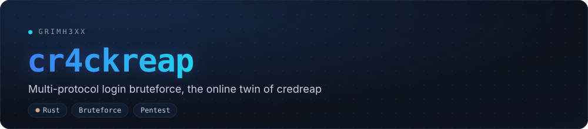

[](https://github.com/grimh3xx/cr4ckreap/actions)
[](LICENSE)


**Multi-protocol login bruteforce in Rust** for authorised pentests — the online
twin of [credreap](https://github.com/grimh3xx/credreap). Concurrent engine with
one protocol per module and optional stop-on-first-hit.

<p align="center"></p>

> ## ⚠️ Authorised use only
> Bruteforce/spray against services without permission is a crime and can lock
> accounts out. Run **only** with scope and authorisation. You are responsible.

## Protocols

| protocol | state |
|---|---|
| `ssh`        | ✅ working (russh password auth; covered by an in-process server test) |
| `ftp`        | ✅ working (USER/PASS, multi-line reply aware) |
| `http-basic` | ✅ working (Authorization: Basic, 401/403 = denied) |

## Usage

```sh
cr4ckreap ssh 10.0.0.5 -U users.txt -P rockyou.txt --stop-on-success
cr4ckreap ftp 10.0.0.5 -u admin -P rockyou.txt --stop-on-success
cr4ckreap http-basic site.com -U users.txt -P pass.txt --path /admin -c 32
```

Mix lists (`-U`/`-P`) or single values (`-u`/`-p`). Hits print as
`[+] VALID user:pass`.

## Tests

```sh
cargo test --release      # unit + in-process SSH server (accept & reject paths)
```

## Roadmap

- SMB and RDP (reusing [rdpr0wl](https://github.com/grimh3xx/rdpr0wl)).
- Per-host jitter/throttle to avoid lockout.

## Build

```sh
cargo build --release
```

## License

MIT. See [LICENSE](LICENSE).
